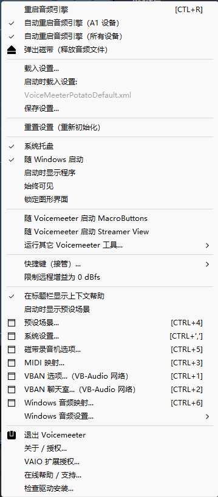

# VoiceMeeter 简体中文汉化

给 [VoiceMeeter](https://vb-audio.com/Voicemeeter/)（VB-Audio 出品的虚拟调音台）做一个中文界面补丁。

**不改动任何 VoiceMeeter 文件** —— 中文是在程序启动的瞬间写进它内存里的。



---

## ⚠️ 先读这一段

* 这是**非官方**的爱好者汉化项目，与 VB-Audio / Vincent Burel **没有任何关系**，也未经其授权或认可。
* **VoiceMeeter®、VB-Audio® 是 VB-Audio 的商标。** 本项目只以说明性目的使用这些名称。
* 本仓库**不包含任何 VoiceMeeter 的二进制文件**（exe / dll / 驱动 / 皮肤图），
  只包含我自己的脚本、纯文本翻译表，以及汉化后的帮助 XML。使用前请自行从
  官方网站安装 VoiceMeeter。
* VoiceMeeter 是捐赠软件。**如果你在用，请去[官网](https://vb-audio.com/Voicemeeter/)支持作者。**
* 本项目只做界面翻译，**不涉及、不绕过、不修改任何授权/许可验证逻辑**。
* 细节见 [NOTICE.md](NOTICE.md)。

---

## 特性

| | |
|---|---|
| 汉化条目 | Potato **552**（64 位）/ **548**（32 位）；Banana **528**（64 位）/ **524**（32 位）。均含 59 组多行消息框 |
| 覆盖 | 主菜单、托盘菜单、上下文菜单、全部对话框、错误与警告提示、通道/总线标签、设备提示、推子标签 |
| 支持版本 | Potato 3.1.3.0 与 Banana 2.1.3.0 的 **32 位 / 64 位构建都已覆盖** |
| 磁盘改动 | **零**。不修改、不替换、不新增任何 VoiceMeeter 文件 |
| 还原 | 关掉 VoiceMeeter，正常启动它 —— 自动回到英文 |
| 依赖 | 只需 Windows 自带的 PowerShell 5.1。不需要 Python、不需要装任何东西 |
| 卸载 | 没有东西需要卸载 |

> ⚠️ VoiceMeeter 有 **32 位（`voicemeeter8.exe` / `voicemeeterpro.exe`）** 和
> **64 位（`voicemeeter8x64.exe` / `voicemeeterpro_x64.exe`）** 两套程序，
> 它们的字符串布局不同，需要各自的补丁计划。开始菜单里的
> 「Voicemeeter Potato」是不带 x64 的那个 = **32 位版**。本仓库两者都已支持。

---

## 快速开始

1. 确保已安装 VoiceMeeter（Banana 或 Potato，32 位或 64 位都行）
2. 下载本仓库（`Code` → `Download ZIP`，或 `git clone`）
3. 双击 **`启动汉化版VoiceMeeter.cmd`**
4. （建议）跑一次开机自启配置，否则开机时是安装程序的原版快捷方式在启英文版：

   ```powershell
   powershell -ExecutionPolicy Bypass -File .\src\setup_autostart.ps1
   ```

之后就点菜单、开对话框，应该都是中文了。

> ⚠️ **一定要用这个启动器启动。** 如果你先自己启动了 VoiceMeeter，菜单的中文是补不上的
> （原因见[原理](docs/how-it-works.md)：菜单文字在创建菜单时就被复制进菜单结构了）。
> 这种情况下启动器会明确提示你。

### 打开还是英文？先看这几条

| 现象 | 原因 / 解法 |
|---|---|
| 双击了 VoiceMeeter 自己的图标 | 那是绕过启动器启动原版。改用 `启动汉化版VoiceMeeter.cmd` |
| 开机后是英文 | 安装程序留下的自启快捷方式直接指向 exe。跑 `src\setup_autostart.ps1` |
| 从开始菜单「Voicemeeter Potato」打开是英文 | 那个是 **32 位版**（`voicemeeter8.exe`）。用启动器启动它即可 —— 现已支持；或用「(x64)」那个条目 |
| 界面中文但菜单是英文 | 启动时补丁没生效（事后用 `-Attach` 补的）。用启动器重新启动 |
| 全部英文，启动器也没报错 | 确认你双击的是本仓库里的 `.cmd`，且没有别的 VoiceMeeter 实例在跑 |

命令行用法：

```powershell
# 自动识别：优先跟随正在运行的实例，否则优先 Potato 64 位
powershell -ExecutionPolicy Bypass -File .\launch-cn.ps1

# 明确指定 32 位 / 64 位构建
powershell -ExecutionPolicy Bypass -File .\launch-cn.ps1 -Product potato-x86
powershell -ExecutionPolicy Bypass -File .\launch-cn.ps1 -Product banana

# 指定产品
powershell -ExecutionPolicy Bypass -File .\launch-cn.ps1 -Product banana

# 汉化一个已经运行的实例（只能改界面标签，菜单改不到）
powershell -ExecutionPolicy Bypass -File .\launch-cn.ps1 -Attach

# 指定安装目录
powershell -ExecutionPolicy Bypass -File .\launch-cn.ps1 -InstallDir "D:\VB\Voicemeeter"
```

---

## 工作原理（一句话版）

VoiceMeeter 会校验自身可执行文件的完整性（并且用自身字节派生皮肤解密密钥），
所以**磁盘上的 exe 改动一个字节就无法启动**——静态补丁走不通。

但实测证明：**这个校验读的是磁盘文件，不是已加载的内存镜像**。
所以启动器这样做：

```
挂起方式启动 VoiceMeeter
   ↓
在它还没开始运行时，把中文写进内存里的 .rdata 字符串区
   ↓
放行主线程 —— 程序启动时构建菜单、绘制界面拿到的就已经是中文
```

详细原理与实验证据见 **[docs/how-it-works.md](docs/how-it-works.md)**，
逆向过程中的工程约束见 **[docs/engineering-notes.md](docs/engineering-notes.md)**。

---

## 覆盖范围与已知限制

### 能汉化的

exe 字符串池（`.rdata`）里的全部界面文本 —— 菜单、对话框、消息框、
通道与总线标签、设备提示、推子/旋钮标签等。

### 改不了的：皮肤图内嵌文字

下面这些文字**不在任何字符串池里**，而是烘焙在 `.rsrc` 中那几张**强加密皮肤图**里
（熵 7.999、无结构，无法解密），因此任何方案都改不了：

```
INTELLIPAN   Color Panel   fx echo   brightness   VOICE      AUDIBILITY
EQUALIZER    Comp.         Gate      Denoiser     Front/Rear Lo/Hi
VIRTUAL INPUTS  HARDWARE OUT  MASTER SECTION  Normal mode  PHYSICAL/VIRTUAL
SPECIAL FX   Reverb/Delay/OFF  External FX  Send/Return/Post  SEL  FX RET
A1~A5 / B1~B3   mono  EQ  Mute  MC  K  solo  0dB  Menu  VBAN  Recorder  Input
```

判定方法：把这些文字在 exe 里逐字搜索（ANSI + UTF-16），命中的都只是更长
字符串的前缀（例如 `Mute Strip #2`），并不存在独立字面量。

### 一处保留英文

`Ok` 按钮：字面量后面紧邻下一个字符串，只有 4 字节可用，放不下「确定」
（4 字节 + 终止符 = 5），故保留 `Ok`。

### 杀毒软件

启动器使用 `WriteProcessMemory` / `VirtualProtectEx` 修改**你自己用户下另一个进程**的内存。
少数杀毒软件可能对这类行为报警。这是实现方式决定的，不是恶意行为；
源码完全公开，可自行审阅。

---

## 其他功能

### 上下文帮助也汉化了

鼠标悬停在控件上时，标题栏会显示该控件的说明。这些文字来自安装目录里的
**帮助 XML**，`translations/help/` 下是两个汉化好的版本（Banana 82 条 / Potato 133 条）：


安装（需管理员权限，会自动请求提升）：

```powershell
powershell -ExecutionPolicy Bypass -File .\src\install_help.ps1          # 安装
powershell -ExecutionPolicy Bypass -File .\src\install_help.ps1 -Restore # 还原
```

要点：

* 帮助 XML 是**纯文本数据文件**，不受 VoiceMeeter 完整性校验影响
  （实测：原版 exe + 汉化 XML 正常启动）。
* 装完需要**重启 VoiceMeeter** 才会读取新文件。
* 提示里的 `API: Patch.insert[4] = 0;` 这一行是程序**实时生成**的接口文本，
  保持原样是正确的（它是给远程 API 用户看的，不是界面说明）。
* 该功能由 `Menu` 里的开关「**在标题栏显示上下文帮助**」控制。它**没有**写进
  `%APPDATA%\VoiceMeeter*Default.xml`，注册表里也没有对应项（我找过），
  所以它是会话级状态 —— 如果看不到提示，去菜单里打开这一项即可。
* 启动器会检查这一项，如果安装目录里的帮助 XML 还是英文会提醒你去装。

---

## 为新版本重新生成补丁计划

本仓库里的 `mempatch_*.json` 是针对以下版本的：

| 文件 | 目标 | 备注 |
|---|---|---|
| `mempatch_potato.json` | `voicemeeter8x64.exe` 3.1.3.0 | 552 项 |
| `mempatch_potato-x86.json` | `voicemeeter8.exe` 3.1.3.0 | 548 项 |
| `mempatch_banana.json` | `voicemeeterpro_x64.exe` 2.1.3.0 | 528 项 |
| `mempatch_banana-x86.json` | `voicemeeterpro.exe` 2.1.3.0 | 524 项 |

VoiceMeeter 升级后字符串位置会变，需要重新生成（只需 Python 3，无第三方依赖）：

```bash
python src/build_mempatch.py --product potato
python src/build_mempatch.py --product potato-x86
python src/build_mempatch.py --product banana
python src/build_mempatch.py --product banana-x86
```

构建器会读你自己安装的 exe，按**英文原文**在字符串池里定位，然后重写计划文件。
同一个 `translations/zh_cn.py` 同时服务四个构建 —— 所以改译文时要注意
**32 位构建里可用空间通常更小**（构建器的 `--check` 会逐条报告放不下的条目）。

> 就算用了过期计划也不会损坏程序：启动器会逐条核对原文，不匹配就报告
> 「原文不符」并放弃应用，而不是盲目写入。

---

## 参与翻译

翻译表在 **[translations/zh_cn.py](translations/zh_cn.py)**，就是纯文本对照：

```python
TRANSLATIONS = [
    # (英文原文, 中文译文)
    ("Stereo Input", "立体声输入"),
    ("Restart Audio Engine\t[CTL+R]", "重启音频引擎\t[CTL+R]"),
    ...
]
```

* 改右边的中文即可，**不要动左边的英文原文** —— 构建器靠它在 exe 里定位字符串。
* `MULTILINE` 是多行消息框，必须**逐行等长**（用空格补齐），
  因为这些字面量被编译器的字符串池后缀合并了，每一行都可能被单独引用。
* 改完跑一次 `python src/build_mempatch.py --check`，它会报告：
  放不下的条目、显示宽度可能被控件裁剪的条目、本版本中找不到的原文。
* 汉字字形宽度约为拉丁字母的 2 倍。**固定宽度的标签区**（例如旋钮下的
  `Gate`）如果译文过宽会被裁掉 —— 实测 `噪声门` 会被裁，`噪声` 正好。
  构建器的显示宽度警告就是干这个用的。

---

## 目录结构

```
voicemeeter-zh-cn/
├─ 启动汉化版VoiceMeeter.cmd      ★ 双击这个
├─ launch-cn.ps1                  启动器（挂起写入内存，无第三方依赖）
├─ mempatch_potato.json           Potato 64 位补丁计划
├─ mempatch_potato-x86.json       Potato 32 位补丁计划
├─ mempatch_banana.json           Banana 64 位补丁计划
├─ mempatch_banana-x86.json       Banana 32 位补丁计划
├─ translations/
│  ├─ zh_cn.py                    翻译表（改这里）
│  └─ help/                       汉化后的帮助 XML
├─ src/
│  ├─ build_mempatch.py           从你本机的 exe 生成补丁计划
│  ├─ peutil.py                   PE / 字符串池工具
│  ├─ install_help.ps1            帮助 XML 的安装与还原
│  └─ setup_autostart.ps1         让开机自启/桌面图标走汉化启动器
└─ docs/
   ├─ how-it-works.md             原理与实验证据
   ├─ engineering-notes.md        逆向工程中发现的硬约束
   └─ images/                     README 截图
```

---

## 致谢

* [VB-Audio VoiceMeeter](https://vb-audio.com/Voicemeeter/) —— 这个优秀的虚拟调音台，请支持作者
* 所有提交翻译改进的贡献者

## 许可

本仓库**我自己的代码与翻译**以 [MIT](LICENSE) 许可发布。
VoiceMeeter 本体、其界面文本与帮助文档的版权归 VB-Audio 所有，
本仓库仅出于本地化目的引用其中的界面字符串。详见 [NOTICE.md](NOTICE.md)。
